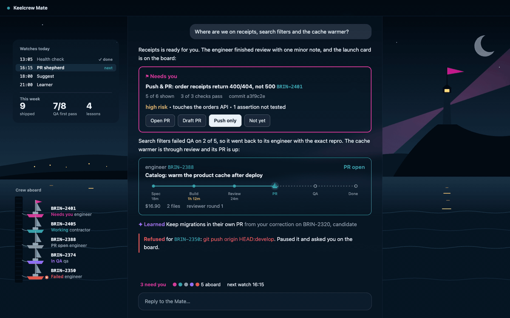
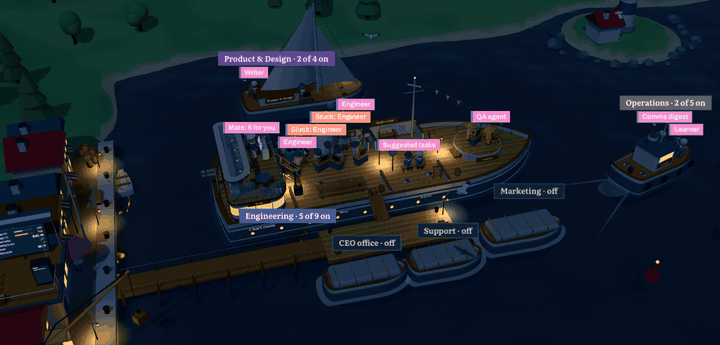
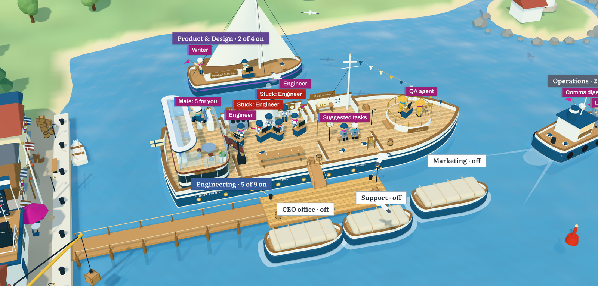
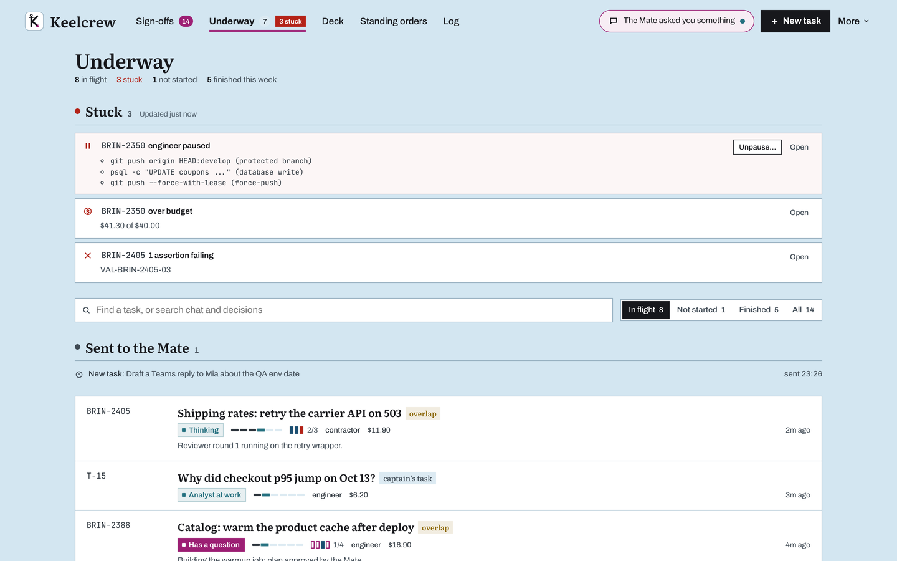
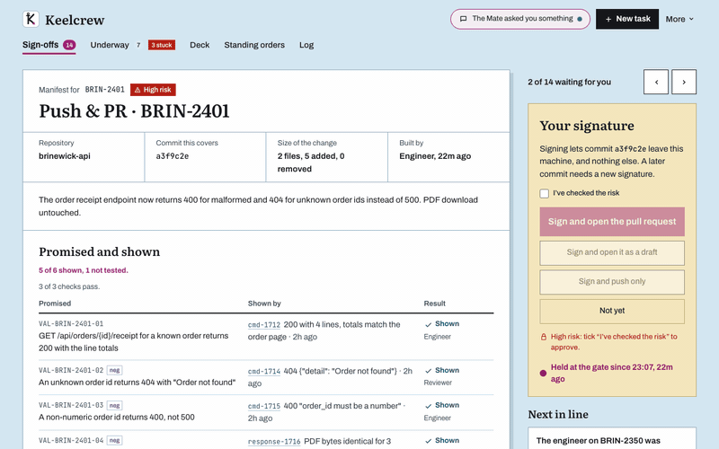
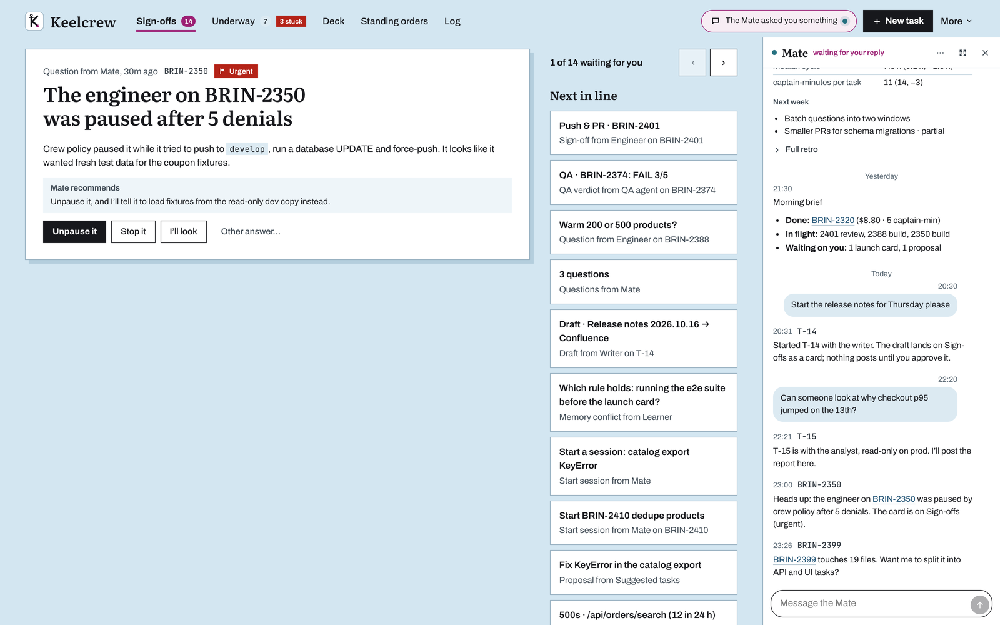

# Keelcrew

**A crew of Claude Code sessions that works your tickets while you keep the helm.**

<p align="center">
  
</p>

Keelcrew is a Claude Code plugin for developers on a Mac who work from Jira or a task list. One Claude Code session, the **Mate**, runs the others: it gives each ticket an engineer session in its own git worktree, with a reviewer and QA behind it, and shows the work on your own private **Keelcrew board**.

Messages and comments wait for your OK. By default engineers push their branch and open their own PR; switch shipping to card mode and a PR waits for your signature.

## Why Keelcrew

- **Real parallel work.** Four engineers by default, each in its own session and git worktree, so tickets keep moving while you're in a meeting.
- **Ticket to tested PR.** Jira tickets arrive on their own. A scout gathers context, the engineer builds, a fresh-eyes reviewer checks the exact commit, and QA tests each acceptance criterion once it's deployed.
- **Merges stay yours.** A policy hook in every crew session and a pre-push hook in every worktree refuse merges, force-pushes, `--no-verify`, and kubectl or terraform changes. A team pack can add rules, never remove one.
- **It learns how you work.** Your corrections, decisions and edits become lessons in a git repo you can read and undo. Switch on the nightly learner and, with your OK, it turns them into [standing orders](docs/crew.md#how-the-mate-learns) every new Mate session follows.
- **Watches while you work.** Switch on a morning brief and standup draft, a PR shepherd that chases stalled reviews and failing CI, fix suggestions from your repos, and a Monday tech-debt review. [See every agent](docs/crew.md).
- **Spend you can see.** Every task shows what it cost. Set a budget per ticket and the Mate warns at 85% and stops the task at 100% to ask you.
- **No Keelcrew server.** Crew files stay in `~/.keelcrew` on your Mac, the board is your own private claude.ai artifact, and Keelcrew sends no telemetry.
- **A board worth opening.** Sign-offs, tasks underway and a 3D Deck where every session is a sailor at its post, by day, dusk or night.

## How it works

### 1. Ask the Mate

Tell the Mate what you need in its session, as at the top of this page. It answers with cards you can act on in the chat. Its look, Harbour light, puts the crew around the conversation: the lighthouse flies a pennant while something waits for you, and each engineer is a boat at the jetty.

### 2. Watch the crew work

The board's Deck shows every session as a sailor at its post: working with a hand to the chin, waving a flag when it needs you, holding a mug when it's done. Each team has its own boat, and teams you've switched off stay moored. Drag to turn it, by night or by day.

<p>
  
  
</p>

Underway lists the same work: stuck tasks first, then every task with its stage, checks and spend.



### 3. Sign off

With card mode on, a PR waits on a launch card: what was promised, what was shown, the commit it covers and its risk. Your signature approves that exact commit; a later commit needs a new one.



### 4. Step in when it matters

When a crew session hits a rule, it stops and the Mate brings you the call, with what it recommends.



The screens above use demo data. The Harbour light image is drawn by the theme's own code in a recreation of the app window, not a screenshot of the app.

## Get started

On a Mac with the Claude desktop app, paste this in Terminal. It installs Keelcrew and opens a new Code session in the app with `/keel-setup` ready to send:

```bash
claude plugin marketplace add Mayank9404/keelcrew && claude plugin install keelcrew@keelcrew && open "claude://code/new?q=%2Fkeel-setup"
```

In that session, pick the folder that holds your repos and press Enter. Answer its one message and click **Install** when the app asks. That session is now your Mate: tell it `start BRIN-123`, or just describe a task.

<sub>You also need git, the GitHub CLI signed in (`gh auth login`) for pull requests, and a paid Claude plan (Pro or higher), since the board is a published artifact. No `claude` command in Terminal? Install it with `brew install --cask claude-code` (2.1.326 or newer). [docs/install.md](docs/install.md) covers connectors, updating and removing.</sub>

## Good to know

- **It runs on your plan.** Every agent is its own Claude Code session and uses your plan's limits, and so does each scheduled job; at most 4 engineers work at once unless you change it. Only the engineer, reviewer, QA, scout, analyst, writer and Jira scan are on at first; scheduled jobs and push notifications stay off until you turn them on. Plan limits assume one person's ordinary use, and Anthropic's terms don't allow sharing an account, so use your own.
- **What the crew reads goes to Anthropic.** The code, tickets, mail and chats it reads are sent under your account's terms and data settings. On a personal plan (Pro or Max), check your privacy setting for model training before you point it at your employer's code.
- **Crew sessions run in Auto mode.** Setup turns it on for sessions in your Mate folder, so they don't stop on prompts. A policy hook in every session, and a pre-push hook in every worktree, refuse what the rules forbid. They read commands as text, so keep GitHub branch protection on the branches that matter.
- **The board is a private claude.ai artifact.** Only you see it unless you share it. A local helper extension lets it read crew state on your Mac and record your approvals. The app warns that a local extension can reach your Mac; this one reads `~/.keelcrew` and the crew's worktrees and starts nothing.
- **Early days.** macOS only, built and tested on Claude Code 2.1.326. Keep the Claude app open: scheduled jobs run only while it is.

## More

- [The crew](docs/crew.md): every agent, how the Mate learns, and the parts.
- [Architecture](docs/architecture.md): the contract every part is built to.
- [Contributing](CONTRIBUTING.md): run it from a checkout, test, release.

Licensed under Apache-2.0. See [LICENSE](LICENSE) and [NOTICE](NOTICE).

Keelcrew is an independent project, not made or endorsed by Anthropic. Claude and Claude Code are trademarks of Anthropic.
